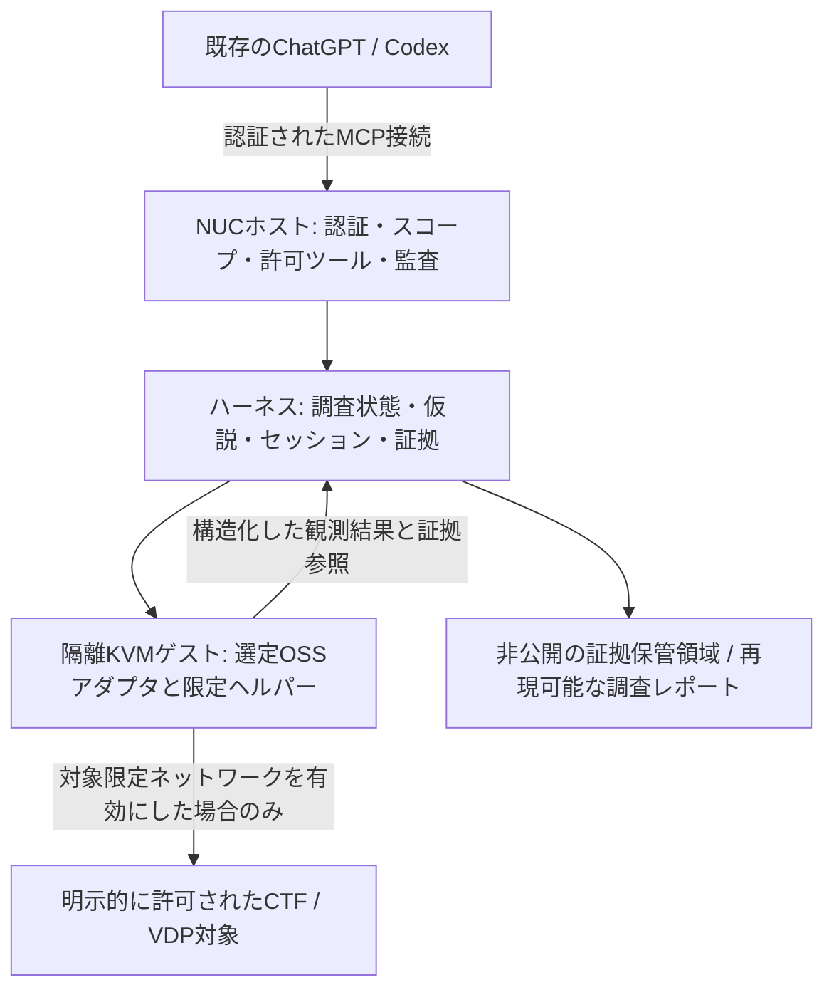

# CTF VDPハーネス

日本語 | [English](README.md)

**今使っているChatGPT／Codexに、MCPを通じて解析道具・探索状態・検証可能な証拠を持たせるための補助ハーネスです。** リポジトリ名は `ctf-vdp-harness` とし、ここを全体設計の置き場とします。

推論と実装を担うAIは、Morukuが選ぶ既存のクライアント／モデルです。モデルと推論強度は各runの実設定を記録し、特定モデルの能力やAPI識別子は仮定しません。このプロジェクトは、そのAIが使う解析環境を補強します。モデルの重みは変更しません。

## 何を作るのか

| 用語 | この設計での役割 |
|---|---|
| AI／クライアント | 仮説を立て、結果を読み、課題用コードを書く既存のChatGPT／Codex |
| ハーネス | スコープ制御、実行上限、継続的な解析セッション、証拠管理、復旧、評価 |
| MCP | AIからハーネスと選定したOSSの機能を呼び出す接続規約 |
| OSSツール | Ghidra、radare2、既存Workbenchなど、実際に解析する道具 |

目標は、調査の重複、デバッガ状態の消失、長い出力の読み落としを減らし、再現可能な発見と、独立に検証したCTF正答率を増やすことです。VDPは、証拠の質と誤検知を別に評価します。ツール数が増えただけで性能向上と判定しません。

**2026-11-09時点では設計資料です。** この更新ではランタイムの実装、デプロイ、スキャナ実行、性能向上の実測は行っていません。既存記録のWorkbenchの基本MCP疎通は、実スキャナ・REA・ChatGPT接続の受入完了を意味しません。

## 全体像



解析ツールはWindowsではなく解析ゲストに置き、ゲートウェイはホスト上の既存の閲覧専用MCPとは分離します。課題ファイルの搬入は既存の読み取り専用ISO方式を維持します。[物理配置](docs/02-architecture.ja.md)、[接続設計](docs/04-connectivity.ja.md)、[ハーネス詳細](docs/08-analysis-harness.ja.md)を参照してください。

最後の記録ではゲストは2 vCPU／4 GiB／20 GiB、vNICなしです。**2026-11-02に隔離セグメント用vNIC追加とリソース拡張の方向性は決定済み**ですが、実施済みとは扱いません。接続はSecure MCP Tunnelを第一候補とし、認証付きHTTPSの代替経路を残します。アカウントでの利用可否と疎通は未受入です。Burpの配置とREAの扱いは引き続き保留です。

## 研究から取り込むもの

- **EnIGMA**：状態を保持する対話型ツールと、読み切れる出力。
- **D-CIPHER**：課題の分解と、行動・観測結果の整理。最初は同じAIが順番に役割を担う構成。
- **CTFusion**：大会基盤との接続を解析ツールから分離し、評価条件を管理。
- **SKILL-SIF**：失敗分類から調査手順を改訂し、未使用課題で評価。
- **HexStrike AI・既存MCP群**：機能分類と限定アダプタの参考。大量の機能を丸ごと公開しない。

[研究と設計の対応表](docs/07-research-to-design.ja.md)に一次資料、採用する仕組み、適用限界をまとめています。HexStrikeは参考資料であり採用依存関係ではありません。他のモデルやベンチマークの成果を、今回のAIやVDPでの実測値として扱いません。

## 作る順番

1. スコープ、クライアントの接続能力、ツール版、比較対象を固定し、ホストを実測する。
2. オフラインで「搬入→限定解析→ページ付き証拠取得→検証済みレポート」を一本通す。
3. 効果を測れる箇所に継続セッションを加える。現行ゲストでは重い解析を同時実行しない。
4. 同じAI・同じ予算で、ハーネスあり／なしを比較する。
5. 受入条件を満たした後、対象限定のネットワーク／VDP機能、任意のCTFd接続を追加する。

既存OSSを優先し、自作は不足する制御・接続・状態・証拠管理に絞ります。[実装計画](docs/10-implementation-plan.ja.md)と[評価設計](docs/09-evaluation.ja.md)に、実装担当AIが進める順序と合格条件を定義しました。

## 資料

| 文書 | 内容 |
|---|---|
| [01 要件](docs/01-requirements.ja.md) | 制約と既存環境の記録 |
| [02 物理構成](docs/02-architecture.ja.md) | ホスト／ゲスト配置と限定ヘルパー |
| [03 MCP選定](docs/03-mcp-selection.ja.md) | 既存資産・候補・採用条件 |
| [04 接続](docs/04-connectivity.ja.md) | 隔離セグメントと接続経路 |
| [05 セキュリティ](docs/05-security.ja.md) | 認証・隔離・スコープ・データ管理 |
| [06 従来の計画と意思決定](docs/06-roadmap.ja.md) | J1〜J5の履歴と未確認事項 |
| [07 研究から設計へ](docs/07-research-to-design.ja.md) | 出典・抽出した仕組み・限界 |
| [08 ハーネス全体設計](docs/08-analysis-harness.ja.md) | 構成・処理・契約・状態・復旧 |
| [09 評価](docs/09-evaluation.ja.md) | 比較条件・要素別比較・未使用課題・導入判定 |
| [10 実装計画](docs/10-implementation-plan.ja.md) | 実装担当AI向け作業と受入条件 |
| [調査レポート雛形](templates/run-report.ja.md) | 証拠と再現手順 |
| [オフライン試行設定例](configs/offline-pilot.example.json) | 非実行の設計例。全アダプタ無効 |

このリポジトリは公開し、運用上の証拠は非公開で管理します。認証情報、実対象アドレス、flag、生の対話ログはこのリポジトリに置きません。ローカルの証拠保管と、公開可能な成果の書き出しを分け、許可されたCTF／VDPの範囲で運用します。

## 設計引継ぎ更新 — 2026-11-09

実装前に[実装契約と受入ケース](docs/11-contracts-and-acceptance.ja.md)を読む。この更新は状態の正本、不変の証拠、再送・復旧、評価境界を具体化し、設計schemaと合成例だけを追加する。実装は別のAIによる後続変更で行う。性能結果や実接続は主張しない。

三つのrepoはそれぞれ単独で使える設計を維持。任意接続は[参照型の受け渡し契約](https://github.com/moruku36/ai-agent-scientist/blob/main/docs/11-harness-boundaries.ja.md)に従い、権限の共有や新agent runtimeを作らない。

## MVP 実装状況・ローカルセットアップ（P1〜P3）

本リポジトリの `src/ctf_mcp/` には、`docs/08`〜`docs/11` の契約に準拠した P1〜P3 MVP ランタイムが含まれています（既存設計文書および非実行設定例 `configs/offline-pilot.example.json` はそのまま維持されています）。

- **Layer 0〜1（状態・ファイル境界・ゲートウェイ）**: SQLite 単一ライター正本 (`storage.py`)、symlink / traversal を遮断する境界付き I/O (`fs_guard.py`)、fail-closed な `ScopeValidator`、SHA-256 署名検証付き `CapabilityCatalog`、単一正本予算管理、秘匿サニタイズ済み `AuditLogger`。
- **Layer 2（ライフサイクル・証拠・アダプタ・検証器）**: `request_id` 冪等性と状態機械 (`runs/actions.py`)、再起動照合と単調増加 fencing token (`runs/recovery.py`)、15 分アイドル失効付きセッションリース (`runs/leases.py`)、SHA-256 ページング付き `EvidenceVault` / `EvidenceRedactor` / `BoundedEvidenceImporter` (`evidence/`)、標準ライブラリ完結の `StaticArtifactInspectorAdapter` (`adapters/static_inspector.py`)、ダイジェスト照合専用の `LocalCtfVerifier` (`verification/ctf_local.py`)。
- **Layer 3〜4（コントローラ・FastMCP サーバー・CLI）**: `HarnessController` (`controller.py`)、認証付き `stdio` / `streamable-http` FastMCP サーバー（`server.py`、`allow_synthetic_adapters=False` 固定、`run.close` 整合状態のホスト側導出）、およびローカル CLI 導線（`cli.py`: `ctf-mcp-server`, `ctf-mcp-admin`）。

### インストール手順（Windows PowerShell / Python 3.12+）

> [!NOTE]
> Windows 環境で `libyaml` の C ビルドツールが利用できない場合、依存パッケージ導入時に `PYYAML_FORCE_LIBYAML=0` を設定してください。

```powershell
python -m venv .venv
.venv\Scripts\Activate.ps1
$env:PYYAML_FORCE_LIBYAML = "0"
python -m pip install -e ".[dev]"
```

### テスト実行

```powershell
$env:PYTHONPATH = "$PWD\src"
python -m pytest -v
```

### CLI 起動・運用手順（`ctf-mcp-admin` / `ctf-mcp-server`）

1. **Run 作成・所有済み成果物の搬入・期待 SHA-256 登録**（秘密値や平文 flag は CLI 引数・ログに含めないこと）:

```powershell
$env:CTF_MCP_DB_PATH = "$PWD\.local_state\harness.db"
$env:CTF_MCP_VAULT_ROOT = "$PWD\.local_vault"
$env:CTF_MCP_CURSOR_HMAC_KEY = "<32文字以上のローカルHMAC鍵>"

ctf-mcp-admin create-run --task-id owned-fixture-1 --scope-revision scope-v1 --auth-ref local-owned-record
ctf-mcp-admin ingest-artifact --run-id <RUN_ID> --source-root C:\path\to\owned_fixtures --rel-path sample.bin
ctf-mcp-admin register-expectation --run-id <RUN_ID> --flag-sha256 <64桁小文字SHA256>
```

2. **クラッシュ照合・ゲスト復帰・状態確認**:

```powershell
ctf-mcp-admin reconcile
ctf-mcp-admin describe-run --run-id <RUN_ID>
ctf-mcp-admin recover-guest --run-id <RUN_ID> --cleanup-verified --note "残存プロセス 0 を確認"
```

3. **FastMCP サーバー起動**（`StaticArtifactInspectorAdapter` + `LocalCtfVerifier` 標準配線、`allow_synthetic_adapters=False`）:

```powershell
# stdio モード（CTF_MCP_CURSOR_HMAC_KEY 未設定時は fail-closed）
ctf-mcp-server --transport stdio --active-run <RUN_ID>

# 認証付き streamable-http モード
$env:CTF_MCP_AUTH_TOKEN = "<十分な強度のローカルBearerトークン>"
ctf-mcp-server --transport streamable-http --host 127.0.0.1 --port 8000
```
