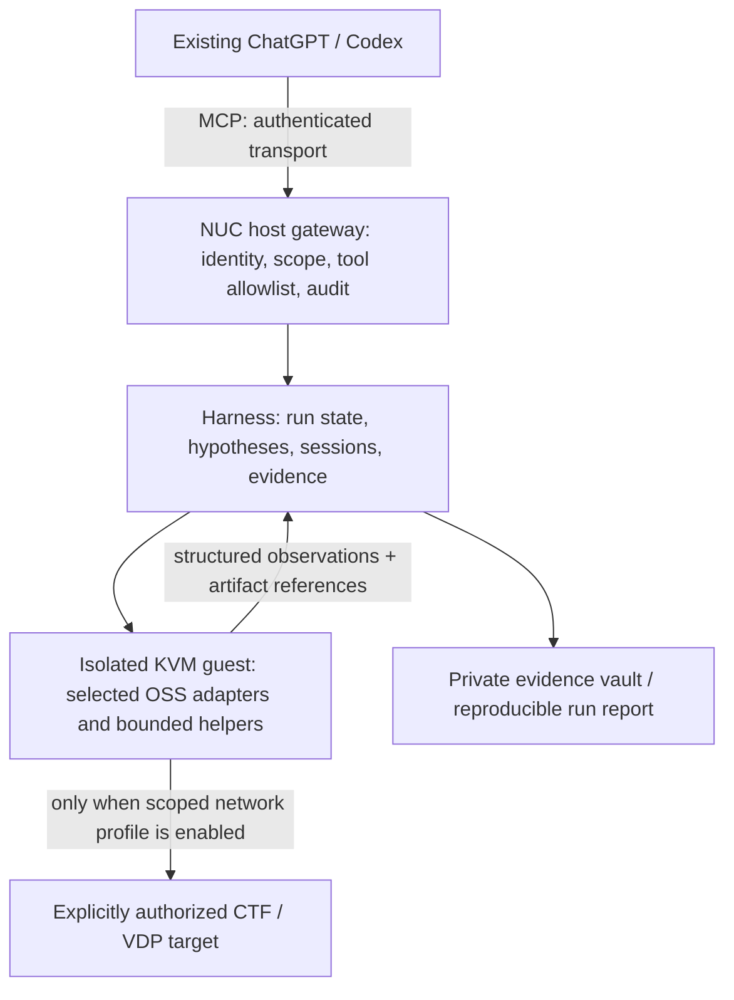

# CTF VDP Harness

[日本語](README.ja.md) | English

**Give Moruku's existing ChatGPT/Codex workflow better analysis tools, exploration state, and verifiable evidence through MCP.** This is the design home for that supporting harness, in the `ctf-vdp-harness` repository.

The reasoning and implementation AI stays in the user's chosen client/model (record the actual model and reasoning setting for each run). This project adds an analysis environment around it. It does not provide another autonomous CTF agent, change model weights, or promise better results merely by installing more tools.

## What this project builds

| Term | Meaning here |
|---|---|
| AI / client | The existing ChatGPT or Codex session that chooses hypotheses, interprets results, and writes task-specific code |
| Harness | Scope enforcement, bounded execution, persistent analysis sessions, evidence management, recovery, and evaluation |
| MCP | The interface through which that AI accesses the harness and selected OSS capabilities |
| OSS tools | The actual analyzers behind narrow adapters, such as Ghidra, radare2, and the existing Workbench |

The intended improvement is practical: fewer repeated investigations, less lost debugger state, better use of long analysis output, more reproducible findings, and higher independently verified CTF solve rates. VDP work is evaluated separately for evidence quality and false positives.

**Status (2026-11-09): design documents only.** No harness runtime, deployment, scanner execution, or performance improvement has been delivered by this update. Earlier lab records report basic Workbench MCP communication; they do not establish scanner acceptance, REA acceptance, or a working ChatGPT connection.

## Architecture



The gateway stays separate from the host's existing read-only report MCP service. Security tool execution stays in the analysis guest, not on Windows. Challenge material continues to enter through the existing read-only ISO process. See [physical architecture](docs/02-architecture.md), [connectivity](docs/04-connectivity.md), and [the complete harness design](docs/08-analysis-harness.md).

The last documented guest has 2 vCPU / 4 GiB / 20 GiB and no vNIC. Adding one isolated-segment vNIC and moving toward resource expansion were **approved on 2026-11-02**; neither is asserted to have been performed. Secure MCP Tunnel is the preferred connection candidate, with the existing authenticated HTTPS fallback retained. Actual account availability and end-to-end connectivity still need acceptance. Burp placement and REA handling remain on hold.

## Research translated into this design

- **EnIGMA:** stateful interactive tool interfaces and manageable output.
- **D-CIPHER:** decomposition and explicit action/observation feedback; sequential roles first.
- **CTFusion:** a separate competition-platform adapter and controlled evaluation.
- **SKILL-SIF:** revise investigation procedures from classified failures, then test on held-out tasks.
- **HexStrike AI and existing MCP servers:** tool-category references and selective adapters; no wholesale toolkit exposure.

The [research-to-design map](docs/07-research-to-design.md) links primary sources and states where each result does and does not apply. HexStrike remains a reference, not an adopted dependency. A research system's benchmark result is not a measured result for Moruku's AI or VDP work.

## Delivery sequence

1. Freeze scope, client capabilities, tool versions, and a baseline; measure the host before resizing.
2. Build a small offline vertical slice: intake → bounded analysis → paged evidence → verified report.
3. Add persistent sessions only where they improve measured tasks; keep heavy analyses serialized on the current guest.
4. Evaluate the same AI with and without the harness under the same budgets.
5. Add scoped network/VDP capabilities and optional CTFd integration only after their acceptance criteria pass.

Prefer existing OSS. Custom code is restricted to missing policy, interface, state, and evidence glue. [Implementation plan](docs/10-implementation-plan.md) gives deliverables and acceptance gates; [evaluation](docs/09-evaluation.md) defines the comparison.

## Documentation

| Document | Contents |
|---|---|
| [01 Requirements](docs/01-requirements.md) | Constraints and recorded lab premises |
| [02 Physical architecture](docs/02-architecture.md) | Host/guest placement and bounded helper stack |
| [03 MCP selection](docs/03-mcp-selection.md) | Existing assets, candidates, adoption constraints |
| [04 Connectivity](docs/04-connectivity.md) | Isolated segment and client transport options |
| [05 Security](docs/05-security.md) | Authentication, isolation, scope, and data handling |
| [06 Earlier roadmap and decisions](docs/06-roadmap.md) | J1–J5 decision history and pending confirmations |
| [07 Research to design](docs/07-research-to-design.md) | Primary sources, extracted mechanisms, limitations |
| [08 Analysis harness](docs/08-analysis-harness.md) | Modules, workflow, contracts, sessions, recovery |
| [09 Evaluation](docs/09-evaluation.md) | Baselines, ablations, held-out tasks, release gates |
| [10 Implementation plan](docs/10-implementation-plan.md) | Work packages for the implementing AI |
| [Run report template](templates/run-report.md) | Evidence and reproducibility record |
| [Offline pilot profile](configs/offline-pilot.example.json) | Non-executable design example; all adapters disabled |

This repository is public; operational evidence remains private. No credentials, real target addresses, flags, or raw session transcripts belong in it. Local evidence storage and an export review are distinct from repository documentation. Only authorized CTF/VDP work is within the intended operating scope.

## Design handoff update — 2026-11-09

Read the [implementation contract and acceptance cases](docs/11-contracts-and-acceptance.md) before implementing. This update specifies state ownership, immutable evidence, retry/recovery behavior and evaluation boundaries; it adds design schemas and synthetic examples only. Runtime implementation belongs to a later AI-led change. No performance result or live integration is claimed.

The three repositories remain independently usable. Optional integration follows the [reference-only handoff contract](https://github.com/moruku36/ai-agent-scientist/blob/main/docs/11-harness-boundaries.md); it does not create shared authority or a new agent runtime.

## MVP Implementation Status & Local Setup (P1–P3)

This repository now includes the P1–P3 MVP runtime under `src/ctf_mcp/`, built strictly on the contracts in `docs/08`–`docs/11`:

- **Layer 0–1 (Storage, FS Guard, Gateway)**: SQLite single-writer state ownership (`storage.py`), symlink/traversal-proof bounded I/O (`fs_guard.py`), fail-closed `ScopeValidator`, `CapabilityCatalog` (pinned SHA-256 descriptors), single-source budget accounting, and sanitized `AuditLogger`.
- **Layer 2 (Runs, Evidence, Adapters, Verification)**: Action lifecycle & `request_id` idempotency (`runs/actions.py`), startup crash reconciliation & strictly monotonic fencing (`runs/recovery.py`), idle-timeout session leases (`runs/leases.py`), SHA-256 paged `EvidenceVault` + `EvidenceRedactor` + `BoundedEvidenceImporter` (`evidence/`), deterministic stdlib `StaticArtifactInspectorAdapter` (`adapters/static_inspector.py`), and digest-only `LocalCtfVerifier` (`verification/ctf_local.py`).
- **Layer 3–4 (Controller, FastMCP Server, CLI)**: `HarnessController` (`controller.py`), authenticated `stdio` / `streamable-http` FastMCP server (`server.py`, `allow_synthetic_adapters=False` by default, server-derived `run.close` checks), and local CLI entrypoints (`cli.py`: `ctf-mcp-server`, `ctf-mcp-admin`).

### Installation (Windows PowerShell / Python 3.12+)

> [!NOTE]
> On Windows environments without C build tools for `libyaml` when building/installing transitive YAML packages, set `PYYAML_FORCE_LIBYAML=0` before `pip install`.

```powershell
python -m venv .venv
.venv\Scripts\Activate.ps1
$env:PYYAML_FORCE_LIBYAML = "0"
python -m pip install -e ".[dev]"
```

### Running Tests

```powershell
$env:PYTHONPATH = "$PWD\src"
python -m pytest -v
```

### CLI Usage (`ctf-mcp-admin` and `ctf-mcp-server`)

1. **Create a run, ingest an owned local artifact, and register expected SHA-256 digest** (secrets/flags never enter CLI arguments or logs):

```powershell
$env:CTF_MCP_DB_PATH = "$PWD\.local_state\harness.db"
$env:CTF_MCP_VAULT_ROOT = "$PWD\.local_vault"
$env:CTF_MCP_CURSOR_HMAC_KEY = "<32+-char-random-local-key>"

ctf-mcp-admin create-run --task-id owned-fixture-1 --scope-revision scope-v1 --auth-ref local-owned-record
ctf-mcp-admin ingest-artifact --run-id <RUN_ID> --source-root C:\path\to\owned_fixtures --rel-path sample.bin
ctf-mcp-admin register-expectation --run-id <RUN_ID> --flag-sha256 <64_HEX_SHA256>
```

2. **Reconcile / recover / inspect**:

```powershell
ctf-mcp-admin reconcile
ctf-mcp-admin describe-run --run-id <RUN_ID>
ctf-mcp-admin recover-guest --run-id <RUN_ID> --cleanup-verified --note "verified zero remaining child PIDs"
```

3. **Launch the MCP server** (`StaticArtifactInspectorAdapter` + `LocalCtfVerifier`, `allow_synthetic_adapters=False`):

```powershell
# stdio (fail-closed if CTF_MCP_CURSOR_HMAC_KEY is unset)
ctf-mcp-server --transport stdio --active-run <RUN_ID>

# authenticated streamable-http
$env:CTF_MCP_AUTH_TOKEN = "<strong-local-bearer-token>"
ctf-mcp-server --transport streamable-http --host 127.0.0.1 --port 8000
```
