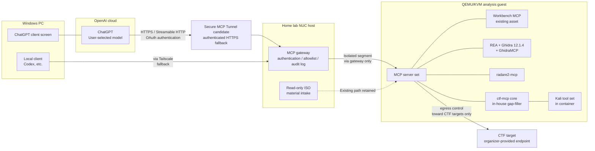

# 02 Overall Architecture

日本語版: [02-architecture.ja.md](02-architecture.ja.md)


**2026-11-09 status:** This is the planned physical architecture, not a deployment record. The recorded guest still has no vNIC; adding one is approved but not verified complete. Secure MCP Tunnel has first priority; Cloudflare in the original diagram is the fallback. Containers/Kali are options, not a full-toolset prerequisite. [Current logical harness design](08-analysis-harness.md) adds run state, evidence and verification.

## 1. Architectural Approach

The exposed surface is consolidated at a gateway on the NUC host, and the analysis guest is placed "inside an isolated segment reachable only from the gateway." The MCP servers run inside the guest, and the guest itself has no direct exposed surface to either the Internet or the home LAN.



## 2. Layer Structure

| Layer | Placement | Role |
|---|---|---|
| Client layer | OpenAI cloud / Windows | ChatGPT calls the MCP tools. The main path is the cloud-side connector; the fallback is a local client on Windows |
| Client route | Secure MCP Tunnel first; authenticated HTTPS fallback | Account/transport acceptance is pending. The fallback uses an outbound host tunnel without new public inbound ports |
| Gateway layer | NUC host | Authentication verification, tool allowlist, audit logging, relay to the guest. Built as a separate system from the existing mcp-server on the host (for read-only reports) |
| Execution layer | QEMU/KVM analysis guest | The MCP server set and analysis tool set. Has exactly one vNIC on the isolated segment, reachable only via the gateway |
| Target layer | External | CTF targets. Egress from the guest is controlled by a firewall |

## 3. MCP Server Set Inside the Guest

Selection details are in docs/03. The division of roles is as follows; overlapping functionality is delegated to the upstream OSS to reduce in-house development.

- **Workbench MCP (existing)**: The foundation for dependency and static analysis, etc. Basic communication has been verified.
- **REA + GhidraMCP**: REA uses the existing placement. For MCP connection to the Ghidra core, GhidraMCP is the first candidate; compatibility with installed Ghidra 12.1.4 must be tested at a pinned revision. The fact that the REA → Ghidra analysis capability has not completed acceptance is carried over.
- **radare2-mcp**: The official radare2 MCP server. The radare2-type tools the Gemini material assumed (function listing, disassembly, etc.) are in principle delegated to this.
- **ctf-mcp core (in-house gap-filler)**: Only the parts OSS does not cover. See the next section.
- **Burp MCP (official PortSwigger extension)**: A candidate for the web category. Because the placement of the Burp core is undecided, it is handled separately from residency inside the guest (docs/03, docs/06).

## 4. ctf-mcp core (In-House Gap-Filling Component)

The tool specifications of the Gemini advance-research material are carried over as "ctf-mcp core." Parts that overlap with OSS (radare2-type, Ghidra-type) are delegated upstream, and core is narrowed to the following.

### 4.1 Scope

- **Crypto / Encoding helpers**: Encoding conversions (Base64 / Hex / URL / ROT13), hash identification, single-byte XOR brute force, deterministic RSA-type arithmetic assistance (pycryptodome, sympy, etc.).
- **Lightweight observation tools**: File metadata and embedded-content detection (wrappers around exiftool / binwalk), HTTP endpoint inspection (httpx wrapper), and other areas where OSS MCP servers are thin.
- **Shared foundation**: Output truncation, path validation, subprocess execution wrapper, timeouts, structured responses. These apply uniformly to all tools in core.

### 4.2 Technology Stack (carried over from the material's specification)

- Python 3.12+ / uv; the MCP framework is FastMCP (PrefectHQ/fastmcp).
- The execution environment is a container based on Kali Linux (kalilinux/kali-rolling) or Ubuntu 24.04. Whether a container platform exists inside the guest is unverified (docs/01 U4), so the placement method is finalized in the phase plan.
- The transport can be switched between stdio and Streamable HTTP via environment variables, with authentication required on every HTTP path (no unauthenticated configuration fallback). However, the exposed surface terminates at the gateway side; core alone is never published directly.

### 4.3 Repository Structure (Planned)

Based on the directory structure in the material. The repository root is `ctf-vdp-harness`; the planned internal helper/package names remain `ctf-mcp core` / `ctf_mcp`.

```text
ctf-vdp-harness/
├── README.md
├── docs/            # This design document set
├── compose.yaml     # Container configuration inside the guest (planned)
├── pyproject.toml
├── .env.example     # Placeholders only. No real values
├── src/
│   └── ctf_mcp/
│       ├── server.py    # FastMCP entry point, tool registration
│       ├── config.py    # Environment variables, workspace, timeouts
│       ├── utils/
│       │   ├── security.py  # Path validation, output truncation
│       │   └── runner.py    # Asynchronous subprocess execution with shell=False
│       └── tools/
│           ├── crypto.py
│           ├── forensics.py
│           └── web_audit.py   # Lightweight observation tools only
└── tests/
```

## 5. Resource Plan

The current guest (2 vCPU / 4 GiB RAM / 20 GiB qcow2) is sized on the premise of the current offline placement of the Workbench + REA/Ghidra. Adding the Kali tool set (which, depending on metapackage composition, can reach tens of GiB), residency of multiple MCP servers, and Ghidra's analysis processing on top of that is strongly expected to exceed both disk and memory.

- Disk: 20 GiB is strained just by deploying the tool set. The first candidate for expansion.
- Memory: Ghidra's analysis alone consumes GiB-scale memory. Contention with multiple resident servers will occur.
- Draft expansion proposal: 4 vCPU / 8–16 GiB RAM / 60–100 GiB. However, because the host (NUC)'s total resources and the usage of other services (the Docker Compose set) are unverified, the scale is left as a decision point in docs/06.
- Combined countermeasure: MCP servers are not all kept resident; the design starts them on demand per category to keep resident memory down.

## 6. Logical harness extension

The gateway enforces per-run capabilities and budgets; guest adapters expose typed operations; a bounded evidence importer transfers selected deliverables into a private host vault. The AI receives short observations with authorized original-output paging. Run metadata and hypotheses survive client reconnects; debugger state does not silently survive VM restart. See [docs/08](08-analysis-harness.md). No general agent framework or autonomous orchestrator is added.
