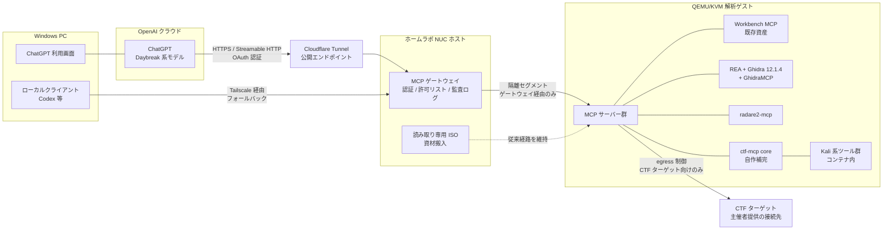

# 02 全体構成

## 1. 構成の考え方

公開面は NUC ホスト上のゲートウェイに集約し、解析ゲストは「ゲートウェイからのみ到達できる隔離セグメントの内側」に置く。MCP サーバー群はゲスト内で動かし、ゲスト自身はインターネットにも家庭 LAN にも直接の公開面を持たない。



## 2. レイヤー構成

| レイヤー | 配置 | 役割 |
|---|---|---|
| クライアント層 | OpenAI クラウド / Windows | ChatGPT が MCP ツールを呼び出す。本線はクラウド側コネクター、フォールバックは Windows のローカルクライアント |
| 公開層 | Cloudflare Tunnel（ホスト発信） | 公開 HTTPS エンドポイントを提供する。ホストにインバウンドの公開ポートは開けない |
| ゲートウェイ層 | NUC ホスト | 認証検証、ツール許可リスト、監査ログ、ゲストへの中継。ホスト上の既存 mcp-server（読み取り専用レポート用）とは別系統として構築する |
| 実行層 | QEMU/KVM 解析ゲスト | MCP サーバー群と解析ツール群。隔離セグメントに vNIC を 1 枚だけ持ち、到達はゲートウェイ経由のみ |
| 対象層 | 外部 | CTF ターゲット。ゲストからの egress はファイアウォールで制御する |

## 3. ゲスト内の MCP サーバー群

選定の詳細は docs/03。役割分担は次のとおりとし、重複する機能は本家 OSS に寄せて自作を減らす。

- **Workbench MCP（既存）**: 依存関係・静的解析等の土台。基本通信は確認済み。
- **REA + GhidraMCP**: REA は既存配置を活かす。Ghidra 本体への MCP 接続は、導入済み Ghidra 12.1.4 に対応する GhidraMCP を第一候補とする。REA → Ghidra の解析能力は受入れ未完了である点を引き継ぐ。
- **radare2-mcp**: radare2 公式の MCP サーバー。Gemini 資料が想定していた radare2 系ツール（関数一覧、逆アセンブル等）は、原則としてこちらに寄せる。
- **ctf-mcp core（自作補完）**: OSS で埋まらない部分のみ。次節。
- **Burp MCP（PortSwigger 公式拡張）**: Web カテゴリの候補。Burp 本体の配置場所が未決のため、ゲスト内常駐とは別枠で扱う（docs/03、docs/06）。

## 4. ctf-mcp core（自作補完コンポーネント）

Gemini 下調べ資料のツール仕様を「ctf-mcp core」として引き継ぐ。OSS と重なる部分（radare2 系、Ghidra 系）は本家に寄せ、core は次に絞る。

### 4.1 担当範囲

- **Crypto / Encoding ヘルパー**: エンコード変換（Base64 / Hex / URL / ROT13）、ハッシュ識別、単一バイト XOR 総当たり、RSA 系の決定論的演算補助（pycryptodome、sympy 等）。
- **軽量な観測ツール**: ファイルメタデータ・埋め込み検出（exiftool / binwalk のラッパー）、HTTP エンドポイント検査（httpx ラッパー）など、OSS MCP サーバーが薄い領域。
- **共通基盤**: 出力トランケート、パス検証、サブプロセス実行ラッパー、タイムアウト、構造化レスポンス。これらは core 内の全ツールに一律適用する。

### 4.2 技術スタック（資料の指定を引き継ぐ）

- Python 3.12+ / uv、MCP フレームワークは FastMCP（PrefectHQ/fastmcp）。
- 実行環境は Kali Linux（kalilinux/kali-rolling）または Ubuntu 24.04 ベースのコンテナ。ゲスト内にコンテナ基盤があるかは未確認（docs/01 U4）のため、配置方法はフェーズ計画で確定する。
- トランスポートは環境変数で stdio / Streamable HTTP を切り替え可能にし、HTTP 時は Bearer トークン認証を有効化できる構成とする。ただし公開面の終端はゲートウェイ側であり、core 単体を直接公開しない。

### 4.3 リポジトリ構成（計画）

資料のディレクトリ構成を基に、名称を `ctf-mcp` に統一する。

```text
ctf-mcp/
├── README.md
├── docs/            # 本設計ドキュメント一式
├── compose.yaml     # ゲスト内コンテナ構成（計画）
├── pyproject.toml
├── .env.example     # プレースホルダのみ。実値は置かない
├── src/
│   └── ctf_mcp/
│       ├── server.py    # FastMCP エントリポイント、ツール登録
│       ├── config.py    # 環境変数、ワークスペース、タイムアウト
│       ├── utils/
│       │   ├── security.py  # パス検証、出力トランケート
│       │   └── runner.py    # shell=False の非同期サブプロセス実行
│       └── tools/
│           ├── crypto.py
│           ├── forensics.py
│           └── web_audit.py   # 軽量な観測ツールのみ
└── tests/
```

## 5. リソース計画

現行ゲスト（2 vCPU / 4 GiB RAM / 20 GiB qcow2）は、現行の Workbench + REA/Ghidra のオフライン配置を前提とした規模である。ここに Kali ツール群（メタパッケージ構成では数十 GiB 規模になり得る）と複数 MCP サーバーの常駐、Ghidra の解析処理を加えると、ディスク・メモリともに不足する見込みが強い。

- ディスク: 20 GiB はツール群の展開だけで逼迫する。増強の第一候補。
- メモリ: Ghidra の解析は単体でも GiB 単位を消費する。複数サーバー常駐との競合が起きる。
- 増強案のたたき台: 4 vCPU / 8〜16 GiB RAM / 60〜100 GiB。ただしホスト（NUC）の総リソースと他サービス（Docker Compose 群）の使用状況が未確認のため、規模は判断ポイントとして docs/06 に置く。
- 対策の併用: MCP サーバーは全常駐とせず、カテゴリ単位でオンデマンド起動する設計とし、常駐メモリを抑える。
