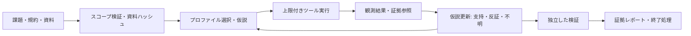

# 08 解析ハーネスの全体設計

[English](08-analysis-harness.md) | [ホーム](../README.ja.md)

**2026-11-09の設計案です。** 論理構成は本書を現行とし、01〜06の物理制約と意思決定を引き継ぎます。以下の予定機能は稼働済み機能ではありません。

## 1. 利用の前提

Morukuが既存のChatGPT／Codexに、許可された課題と資料を渡して調査します。計画・解釈・実装は同じAIが担い、MCPは限定した機能を提供します。ハーネスはスコープを強制し、観測した作業を保存します。常駐する自律探索、モデル固有ルーティング、暗黙の他エージェント起動は含めません。

最初はオフラインCTF資料と管理下の試料から始め、ライブCTF・VDPを後段にします。既存AIが普段の開発環境で課題用コードを書けることと、このMCPに任意シェル・スクリプト実行権限を渡すことは別です。

## 2. 構成要素と責務

| 要素 | 配置・責務 |
|---|---|
| クライアントプロファイル | ChatGPT／Codex。実際のモデル表示名、接続方式、使えるツール、クライアント側制約を記録。UI名からAPIモデルIDを推測しない。 |
| ゲートウェイ／ポリシー | NUCホスト。閲覧専用MCPとは別のサービス主体。認証、調査・利用者の紐付け、機能・対象・予算の検証、監査要約。 |
| 調査コントローラ | ゲートウェイ側の制御情報。スコープ版、課題一覧、仮説台帳、実行状態、セッション期限、検証状態、終了理由を管理。対象の出力は権限変更の根拠にしない。 |
| アダプタ監督 | ゲスト内の実行面。受入済みOSSだけを必要時に起動。型付き要求の変換、資源・プロセス制限、子プロセスを含む停止。 |
| 証拠サービス | ゲスト内の一時領域と、ホスト側非公開保管領域への限定取込。内容ハッシュ、出所、出力ページ、再現情報を保存。取込時にサイズ・型・パスを検証し、任意ホストパスへの書込を許可しない。 |
| 検証／レポート | 登録したローカルCTF正答検証、またはレビューで定めたVDP再現手順。証拠参照付きレポートを生成。外部提出は別操作。 |
| 任意の大会アダプタ | CTFdの課題一覧・取得・提出。解析ツールとは分離し、初期状態では無効。対象スコープを拡張しない。 |

ホストは制御面であり、不審な解析バイナリを動かす場所ではありません。ゲストは使い捨てとします。証拠取得は調査ID・利用者に基づいて認可し、公開オブジェクトURLや共有ホストディレクトリを使いません。

## 3. 一回の調査



1. **搬入**：大会／プログラム規約、許可根拠、スコープ版、許可操作、有効期限、資料ハッシュと入手元を記録。既存のオフラインISO搬入を維持。スコープ未確定ではネットワーク機能を有効にしない。
2. **計画**：目的、既知の事実、競合する仮説、区別に必要な次の観測、残予算を記録。短い作業上の根拠を残し、非公開の内部思考の記録は要求しない。
3. **観測**：分野に応じた機能を選択。ゲートウェイとアダプタで引数検証し、予算を確保して実行。ツール失敗を「脆弱性なし」と解釈しない。
4. **保存**：短い構造化結果と証拠ID・ページカーソルを返す。AIの要約は派生情報と明示し、原文を置き換えない。
5. **見直し**：証拠を仮説の支持・反証・判断不能に対応付ける。試した操作を記録して偶発的な繰返しを防ぐ。意図的な再実行は可能にする。
6. **検証**：可能ならローカルの厳密なCTF正答検証、VDPでは許可範囲内の最小再現。確信度だけで状態を昇格させない。
7. **終了**：レポートを固定し、セッション終了、一時的通信許可を解除。選定・秘匿処理した証拠だけ退避し、ゲストをロールバック。終了処理の成功も別に検証。

## 4. 調査・証拠の契約

本書のインターフェース名は設計案で、上流MCPに実在する名前ではありません。

調査マニフェストは、`run_id`、所有者、課題ID、モード（`offline_ctf`／`scoped_ctf`／`vdp`）、スコープ版・ハッシュ・期限、資料ハッシュ、アダプタのコミット・設定ハッシュ、実クライアント／モデル表示名、手順版、予算を持ちます。認証情報の値やflagは含めません。

共通結果形式の例：

```json
{
  "run_id": "example-run",
  "action_id": "example-action",
  "status": "ok",
  "summary": "構造調査が完了。脆弱性の判定ではない。",
  "evidence": [{"id": "opaque-evidence-id", "sha256": "HASH_PLACEHOLDER", "kind": "tool_output"}],
  "truncated": true,
  "next_cursor": "opaque-page-cursor",
  "error": null,
  "usage": {"wall_ms": 150, "output_bytes": 6000},
  "provenance": {"adapter_revision": "COMMIT_PLACEHOLDER", "scope_revision": "scope-1"}
}
```

状態は `ok`／`partial`／`timeout`／`cancelled`／`denied`／`tool_error`。欠損や実行失敗を、成功した空の発見一覧として返しません。発見候補には、位置、対象版、観測、前提、影響仮説、再現資料、反証、検証状態を別に持たせます。

証拠メタデータは入力ハッシュ、ツール名・版、秘匿処理した引数、時刻、原文／派生の区別、参照範囲を保持。規約上許される場合に原文を非公開保管し、AIには上限付きページを渡します。秘匿処理で取得できない部分はハッシュと省略表示を残し、黙って記録を改変しません。IDの推測で他調査の証拠を読めないようにします。

## 5. 小さな公開機能面

初期目安はプロファイルごとに必要な5〜10機能程度です。上流の機能数をそのまま公開せず、安定した型付きスキーマに必要な処理をまとめます。

| 機能案 | 契約・初期状態 |
|---|---|
| `run.describe` | スコープ、受入済みアダプタ、残予算、実行履歴。秘密情報なし。 |
| `artifact.inspect` | ファイルIDと列挙型の表示指定。展開量を制限。任意パス不可。 |
| `analysis.query` | 受入済みエンジン、資料ID、関数・文字列・逆コンパイル・ルール結果などの型付き操作。コマンド文字列不可。 |
| `helper.transform` | 明示した変換・算術操作と入力上限。 |
| `session.control` | 受入済み対話アダプタのopen／inspect／step／close。汎用コマンド・スクリプト欄なし。 |
| `evidence.read` | 認可済み証拠IDとページ指定。原文は未信頼データと表示。 |
| `hypothesis.update` | 短い仮説、状態、証拠参照、次の観測。 |
| `run.verify` | 登録済みローカル検証器ID。検査内容と限界を返す。 |
| `run.close` | 作業停止、レポート固定、終了確認。 |

Web／VDPでは不要な分野を外し、対象限定の観測機能に置換します。無効ツールは一覧から除外し、直接呼出も拒否します。MCPのread-only注釈はUI向け情報であり、通信や副作用を認可する仕組みではありません。

## 6. 継続的な対話セッション

セッションを調査ID、資料／許可済み接続先、アダプタ版、有効期限に紐付けます。初期はゲストあたり対話セッション1つ・重い解析1つまで。試行値は、操作60秒、無操作15分で終了、調査全体にも予算、出力1ページ約4,000文字。実測する初期値であり、本番での受入済み上限ではありません。

開始、上限付き観測、型付きデバッガ操作、状態確認、取消、終了を提供。デバッガ起動は状態を見るだけでも動的実行なので、別プロファイルと使い捨て隔離環境に限定します。遠隔CTF接続はスコープ内の接続先とバイト・時間上限が必要です。任意デバッガコマンド、シェル脱出、Python評価、任意プラグイン、無制限r2実行は公開しません。

継続処理は追跡可能な期限の下でのみ許可。状態確認は新しい解析を起動しません。タイムアウト／取消で子プロセスを含めて停止し、部分証拠を返し、残存を確認します。クライアント切断で新規処理を止め、期限切れで終了。監督プロセス／VM再起動後は状態消失を明示し、保存資料と仮説から再開します。敵対的なファイルを解析するため、受入済みツールでも隔離を必須とします。

## 7. スコープ・通信・機微な証拠

オフラインでは対象通信も大会提出も無効。通信する調査では、実際の大会／プログラムの対象ホスト・ポート・パス境界、プロトコル、メソッド、リクエスト数・並列数・速度、禁止操作、時間帯、データ扱い、許可根拠を持たせます。初期は拒否。DNS解決、転送先、別アドレス、新しい接続ごとに検証し、ホスト名一致だけで管理面・メタデータ・自宅LANへ到達させません。プロキシ／ブラウザ／CTFd経路にも同じ制御を適用。

VDPは提供ソース・取得済み通信から始め、許可された低負荷観測へ進めます。汎用の能動スキャナは初期無効。対象規約の変更で通信許可キャッシュを無効化します。発見は「候補→再現済み→報告準備済み→提出済み→受理済み」を証拠に応じて進め、再現だけで提出・受理扱いにしません。

保管は次の三種類に分けます。

- **監査**：操作の要約と宛先。生の引数・結果、認証情報、flagは保存しない。
- **非公開証拠**：規約が許す原文を調査ごとの認可・保存期限付きで保持。自動Gitコミットしない。
- **書き出し**：選択・確認・秘匿処理したレポート。秘密保持のため一部を共有できない場合は明記。

ゲストからの成果退避は限定した証拠取込経路だけとし、解析ツールにホスト一般書込を与えません。保存期間はプログラム規約に従い、削除手順とアクセス記録を設けます。生の証拠を学習や別課題のメモリに自動投入しません。

## 8. 現環境とクライアントへの適合

NUC／KVM配置とJ1〜J5を維持。Kali全体の導入や全ツール常駐は前提にしません。最も軽い受入済みアダプタから、最大RSS・ディスク・CPUを測り、重い処理を直列化。資源不足は明示して止め、実測後に拡張量を決めます。

現在の公式資料は、ChatGPTカスタムMCPプラグインのread/writeツール、streaming HTTP／SSE、Secure MCP Tunnelの選択肢を説明しています。ワークスペースとセキュリティ制約が適用されます（[OpenAI公式](https://developers.openai.com/api/docs/guides/custom-mcp-server)）。Codexはstdio／Streamable HTTP設定を説明しています（[公式MCPガイド](https://learn.chatgpt.com/docs/extend/mcp?surface=cli)）。製品としての説明と、Morukuのアカウントで接続済みであることは分けます。実クライアントで認証、ツール更新、証拠ページ取得、再接続を受入確認。ChatGPT WebがローカルCodex設定を自動利用するとは扱いません。

Secure MCP Tunnelを第一候補とし、認証付きHTTPSを代替とします。トンネルは機能・対象制御の代わりにはなりません。エンドポイント認証とCloudflare Accessの組合せも、ブラウザログイン成功だけで判断せず、実クライアントの一連の操作で検証します。

## 9. 実装範囲

既存計画のPython／uv／FastMCPを維持し、受入可能なOSSで足りるか確認した上で不足する接着部分だけを実装します。新しいエージェントフレームワークは不要です。スキルは課題分野ごとの短い作業ガイドとし、開発用課題の失敗からオフラインで改訂。評価前に手順版とアダプタを固定します。将来sleep／memoryプロジェクトへ渡す場合も、確認済みの一般化した教訓だけを対象とする別設計で、今回の実装範囲には含めません。

[評価](09-evaluation.ja.md) | [実装作業](10-implementation-plan.ja.md)
