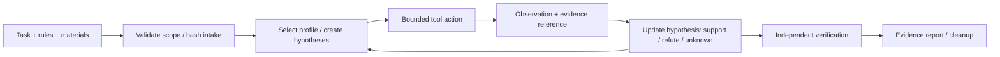

# 08 Analysis Harness: Whole-System Design

[日本語](08-analysis-harness.ja.md) | [Home](../README.md)

**Design proposal, 2026-11-09.** This is the current logical design. Documents 01–06 retain the physical constraints and decision history; planned components below are not deployed components.

## 1. Operating model

Moruku opens an existing ChatGPT/Codex session, provides an authorized task and materials, and uses the harness to investigate. The same AI performs planning, interpretation, and implementation. MCP exposes bounded capabilities; the harness enforces the scope and retains observable work. There is no background autonomous campaign, model-specific routing, or implicit delegation.

Start with offline CTF artifacts and local controlled fixtures. Add live CTF and VDP profiles later. The existing AI may write task-specific code in its normal development workflow; that does not confer arbitrary shell or script execution through this MCP gateway.

## 2. Components and ownership

| Component | Placement / responsibility |
|---|---|
| Client profile | ChatGPT or Codex; records actual model label, supported transport, available tools, and client restrictions. Never fabricates an API model identifier from a UI name. |
| Gateway / policy engine | NUC host, separate service identity from read-only reports. Authenticates, binds run and principal, validates capabilities, enforces tool/target budgets, and records audit summaries. |
| Run controller | Gateway-side control metadata: scope revision, task manifest, hypothesis board, queued/running actions, session leases, verification state, and stop reason. Does not interpret target instructions as policy. |
| Adapter supervisor | Guest-side execution plane. Starts only accepted OSS adapters on demand, translates typed requests, enforces resource/process limits, and cancels process trees. |
| Evidence service | Guest staging plus a bounded host-side importer into a private vault. Stores content-addressed artifacts, provenance, output pages, and reproducibility metadata. Importer validates size/type/path and cannot write arbitrary host paths. |
| Verification / reporting | Local deterministic challenge verifier or a reviewer-defined VDP reproduction procedure. Generates a report referencing evidence; external submission is separate. |
| Optional platform adapter | CTFd inventory/download/submission interface, isolated from analyzers and disabled initially. Does not broaden target scope. |

The host gateway is a control plane, not a location for running untrusted analysis binaries. The guest is disposable. Evidence retrieval is authorized by run/principal and happens through the evidence service, not a public object URL or shared host filesystem.

## 3. One investigation



1. **Intake:** record organizer/program rules, permission basis, scope revision, allowed operations, expiration, material hashes and source. Existing offline ISO intake remains authoritative. Rejected or missing scope cannot enable network tools.
2. **Plan:** record the objective, known facts, competing hypotheses, next discriminating observation, and remaining budget. Record concise operational rationale, not private hidden reasoning.
3. **Observe:** choose a category-specific capability, validate arguments at both gateway and adapter, reserve budget, and run it. A failed tool is an analysis failure, not a clean target.
4. **Preserve:** return a short structured observation plus evidence ID and page cursor. An AI-written summary is labelled derived and never replaces the captured source.
5. **Reassess:** attach evidence to a hypothesis as supporting, refuting, or inconclusive. Record attempted actions to prevent accidental duplicate work; deliberate repeats remain possible.
6. **Verify:** exact local CTF verification where available, or a minimal permitted VDP reproduction with its limitations. Confidence alone never upgrades a finding.
7. **Close:** freeze a report, terminate sessions, revoke temporary egress, export only selected/redacted evidence, then roll back the guest. Verify cleanup separately.

## 4. Run and evidence contracts

All contracts here are proposed interfaces, not upstream MCP tool names.

A run manifest contains `run_id`, owner, task ID, mode (`offline_ctf`, `scoped_ctf`, `vdp`), scope revision/hash and expiry, artifact hashes, adapter commit/config hashes, actual client/model label, instruction revision, and budgets. No credential value or flag goes into the manifest.

Each result uses a common envelope:

```json
{
  "run_id": "example-run",
  "action_id": "example-action",
  "status": "ok",
  "summary": "Structure inspection completed; this is not a vulnerability verdict.",
  "evidence": [{"id": "opaque-evidence-id", "sha256": "HASH_PLACEHOLDER", "kind": "tool_output"}],
  "truncated": true,
  "next_cursor": "opaque-page-cursor",
  "error": null,
  "usage": {"wall_ms": 150, "output_bytes": 6000},
  "provenance": {"adapter_revision": "COMMIT_PLACEHOLDER", "scope_revision": "scope-1"}
}
```

Allowed status values: `ok`, `partial`, `timeout`, `cancelled`, `denied`, `tool_error`. Missing results and tool errors must never be serialized as a successful empty finding. A finding separately records location, affected version, observation, preconditions, impact hypothesis, reproducer reference, contradictory evidence, and verification state.

Evidence metadata includes source input hash, tool identity/version, sanitized parameters, timestamps, raw/derived distinction, and source ranges. Raw output is stored in the private vault when permitted; the AI receives bounded pages. Redaction may limit what the client can retrieve; retain hashes and explicit omission markers rather than silently altering the record. Different runs cannot access each other's evidence by guessing IDs.

## 5. Small public capability surface

Use approximately 5–10 task-relevant exposed tools per profile as an initial design target, not a fixed upstream tool count. A logical namespace may map multiple backend calls behind a stable schema.

| Proposed capability | Contract / default |
|---|---|
| `run.describe` | Scope, accepted adapters, remaining budgets, prior actions; no secrets |
| `artifact.inspect` | File ID + enumerated view, bounded extraction; no arbitrary paths |
| `analysis.query` | Accepted engine + artifact ID + typed operation (functions, strings, decompile, rule results); no command string |
| `helper.transform` | Explicit encoding/arithmetic operations and bounded input |
| `session.control` | Typed open/inspect/step/close on an accepted interactive adapter; no generic command or script field |
| `evidence.read` | Authorized evidence ID + bounded page; original data labelled untrusted |
| `hypothesis.update` | Concise claim, status, evidence links, next observation |
| `run.verify` | Local registered verifier ID; reports checks and limitations |
| `run.close` | Cancel work, freeze report, and verify cleanup |

Web/VDP profile replaces irrelevant categories with a narrowly scoped observation capability. Do not list all backend tools simply because the server supports them. A disabled tool must be absent from the visible catalog and denied on direct invocation. MCP read-only annotations are UI hints, not a network or side-effect authorization mechanism.

## 6. Persistent interactive sessions

A session is bound to run, artifact/authorized endpoint, adapter revision, and a lease. Start with one active interactive session and one heavy analysis job per guest. Proposed initial limits: 60 seconds per action, 15-minute idle session expiry, explicit whole-run budget, roughly 4,000 characters per returned page. These are conservative pilot settings to measure, not accepted production limits.

The interface supports start, bounded observation, typed debugger operations, status, cancel, and close. Debugger launch is dynamic execution even if the immediate action only inspects state; it belongs in a separate profile and disposable sandbox. Remote CTF interaction requires a scope-bound endpoint and byte/time limits. Arbitrary debugger commands, shell escapes, Python evaluation, arbitrary plugin loading, and unrestricted r2 execution are not exposed.

Processes may continue only under a tracked lease; polling does not create a new analysis. On timeout/cancel, stop the child process tree, report partial evidence, and check for leftovers. Client disconnect suspends new work; lease expiry kills the session. After supervisor/VM restart, mark sessions lost rather than pretend debugger state survived; resume from immutable artifacts and recorded hypotheses. Isolation is mandatory even for accepted tools because parsers process hostile files.

## 7. Scope, network, and sensitive evidence

Offline profile has no target egress and no platform submission. Network-enabled runs require the actual program/competition scope: allowed hosts/ports/path boundaries, protocols, methods, request/concurrency/rate limits, excluded operations, time window, data handling, and authorization evidence. Defaults remain deny. DNS resolution, redirects, alternate addresses, and each new connection are checked; a hostname match alone does not permit access to management, metadata, or home-LAN addresses. The same policy applies to proxy/browser/CTFd routes.

For VDP, start with supplied source and captured traffic, then low-impact permitted observations. No generic active scanner is enabled by default. Changes in program scope invalidate cached network permissions. Findings progress through candidate → reproduced → report-ready → submitted → accepted only with the corresponding evidence; submission/acceptance are not inferred from reproduction.

Three storage classes are separate:
- **Audit:** sanitized metadata and destination summaries, no raw arguments/results, credentials, or flags.
- **Private evidence:** access-controlled, per-run retention/expiry, potentially sensitive original outputs when rules permit; never an automatic Git commit.
- **Export:** explicitly selected, reviewed, redacted report/artifacts. Export can be incomplete if confidentiality prohibits sharing.

The evidence importer is the only bounded guest-to-host deliverable channel; it does not grant analysis tools general host writes. Retention follows program rules, with deletion procedures and an access audit. No training or cross-task memory ingest of raw evidence.

## 8. Physical fit and client compatibility

Preserve the NUC/KVM placement and J1–J5 decisions. No full Kali metapackage or always-resident stack is a prerequisite. Begin with the lightest accepted adapter, collect peak RSS/disk/CPU, serialize heavy jobs, and stop cleanly on low resources. Decide actual expansion after measurement; do not silently resize.

Official documentation currently describes ChatGPT custom MCP plugins with read/write tools, streaming HTTP/SSE and a Secure MCP Tunnel option, subject to workspace/security restrictions ([OpenAI guide](https://developers.openai.com/api/docs/guides/custom-mcp-server)). Codex documentation describes stdio and Streamable HTTP configurations ([official MCP guide](https://learn.chatgpt.com/docs/extend/mcp?surface=cli)). These are product capabilities, not a completed connection in Moruku's account. Test each actual client, authentication flow, descriptor refresh, resource paging, and reconnect. A ChatGPT web conversation does not automatically consume local Codex configuration.

Secure MCP Tunnel stays the first candidate; authenticated HTTPS is fallback. A tunnel does not replace tool/scope enforcement. Final endpoint authentication and Cloudflare Access compatibility must be exercised end to end, not inferred from successful browser login.

## 9. Implementation boundary

Implement only missing glue in the existing planned Python/uv/FastMCP stack after checking whether an accepted OSS component can supply it. No new agent framework is needed. Skills are short operational guides, versioned per task family. Improvement from failures happens offline on development tasks; the skill revision and adapters are frozen before evaluation. Future integration with a sleep/memory project may consume only reviewed, generalized lessons and requires a separate design; it is not part of this delivery.

[Evaluation](09-evaluation.md) | [Implementation work packages](10-implementation-plan.md)
